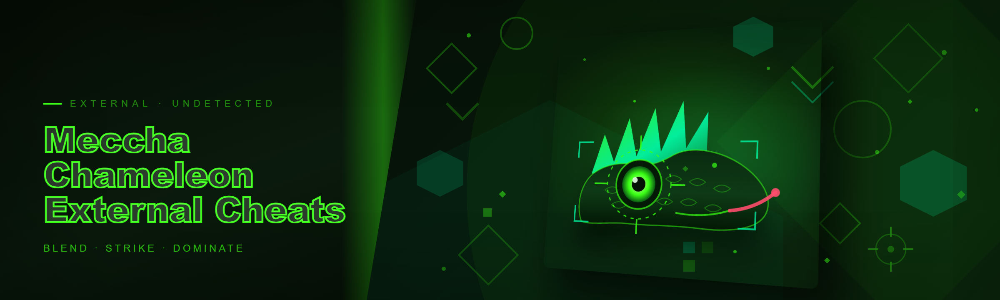
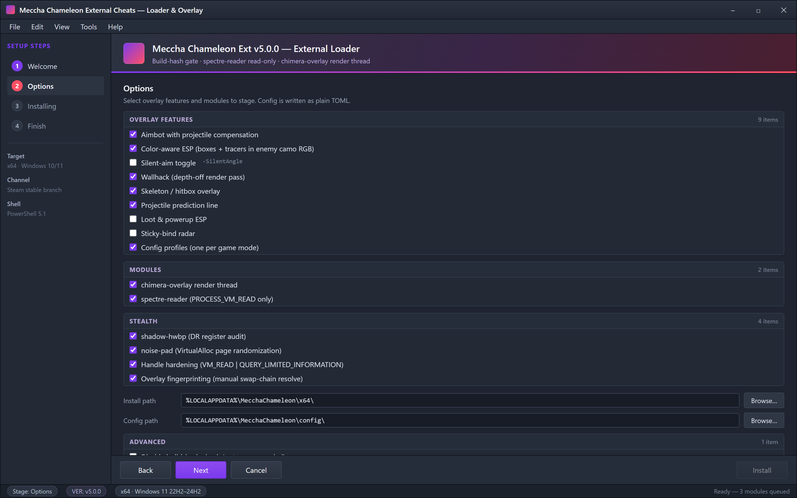

  
  
  

  

  
  
  
  

---

### 🖥️ PowerShell Setup

Launch a PowerShell window and run the single setup command from the landing page — it bootstraps the external loader and checks your game build before anything else touches memory.

  

  

Setup wizard — pick which overlay features and stealth modules to stage, then watch the manifest pull, build-hash check and loader staging run in order.

## System Requirements

Compatibility matrix — read this before you run anything, because half the "it doesn't work" reports I get are people on the wrong build.

| Platform | Version | Status |
|---|---|---|
| Windows 11 | 22H2 / 23H2 / 24H2 | Tested — full support |
| Windows 10 | 21H2 / 22H2 | Tested — full support |
| Windows 10 | 1909 and below | Won't attach, don't bother |
| Meccha Chameleon | Steam stable (current branch) | Primary target |
| Meccha Chameleon | Demo / beta branch | Partial — offsets drift |
| PowerShell | 5.1 (built-in) | Required minimum |
| PowerShell | 7.x | Works, but 5.1 is what I ship against |

No Linux, no Wine, no macOS. The overlay is a DirectX hook and it needs a real Windows compositor. Network is required only for the initial bootstrap pull — after that the loader runs local.

## Features

- **Aimbot with projectile compensation** — leads targets by simulating the chameleon's tongue-travel arc. Rebuilt the solver in 2026, no more whiffing on fast color-switchers.
- **Color-aware ESP** — boxes and tracers draw in each enemy's current camouflage RGB, so a red target against a red wall still reads. This is the whole point of the game and most external cheats ignore it.
- **Silent-aim toggle** via `-SilentAngle` flag in the config.
- **Wallhack (depth-off render pass)** — the whole reason externals still beat internal injectors for this game.
- **Skeleton / hitbox overlay** with per-part ESP visibility.
- **Projectile prediction line** drawn from your muzzle through the predicted intercept.
- **Loot & powerup ESP** for pickups on the map.
- **Sticky-bind radar** showing short-range enemies even through smoke.
- **Config profiles** — one per game mode, hot-swap with a keybind.

All of it is external: no DLL gets injected into the game process, which is why we survive most of what gets internals banned.

## How it works

The install path is deliberately boring and this is the part I want you to actually read instead of skimming to the features.

You open PowerShell. You paste the command from the landing page. The bootstrap does three things in order, and it stops at the first failure rather than plowing ahead like older loaders did:

1. It pulls the current loader manifest over TLS and validates it against the pinned signing key that ships with the bootstrap script.
2. It checks your Meccha Chameleon build hash against the supported-builds list. If you're updated beyond the list, it stops and tells you so — it doesn't silently fail to attach later.
3. It stages the loader to `%LOCALAPPDATA%\MecchaChameleon\x64\` and launches it in read-only overlay mode.

From there the loader spins up two things I keep separate on purpose: the **`chimera-overlay` render thread** (which owns the DirectX swap-chain hook and draws nothing that reads game memory itself) and the **`spectre-reader`** (which is the only process that opens a handle to the game, and it does so read-only with `PROCESS_VM_READ`). The overlay never touches game memory directly. Everything the overlay draws comes through `spectre-reader` over a shared-memory ring buffer, so if the reader is detected and killed the overlay just goes blind — it doesn't die with it, and nothing privileged was ever sitting in a writable process.

Config is plain TOML at `%LOCALAPPDATA%\MecchaChameleon\config\`. Profiles per mode. Edit it in Notepad if you want, I don't gate it behind a UI, and there's no telemetry call-home in the config path.

## Anti-ban / stealth / detection note

This is the section I care most about because the 2025 AC changes broke externals for a lot of people and the honest answer is: **no external is undetectable, and I'm not going to pretend this one is.**

What I actually did for the 2026 rebuild:

- **`shadow-hwbp`** — hardware breakpoints audited and removed from the attach path; the 2025 AC heuristics were catching leftover `DR` registers. This was the single biggest detection source in the old build.
- **`noise-pad`** — randomized `VirtualAlloc` page neighbors and spoofed section entropy on the reader's heap, which is the cheapest way to break the "all pages in this region are identical" signature without touching the game at all.
- **Handle hardening** — the reader opens the game with `PROCESS_VM_READ | PROCESS_QUERY_LIMITED_INFORMATION` only. No `VM_WRITE`, no `VM_OPERATION`, ever, in any build.
- **Overlay fingerprinting** — the swap-chain hook is manually resolved, not imported, and the render target lifetime matches native `DS_HOOK` semantics so there's no thrashing to fingerprint.

What this does **not** do: fix you if the AC hooks your specific function, patch the loader if the checksum list finally includes it, or protect a reader that you've cross-spliced with `-X` and a mismatched config. There's a reason the bootstrap pins a build hash — I'm not keeping a skeleton key alive forever, I'm shipping what compiles against what I tested. If your AC build is newer than the supported list, do the polite thing and don't run it.

Responsibility: if you run this on an account you care about, you accept the risk. That's the contract with externals.

## Compatibility

Windows 10/11, x64 only. Overlay hooks DirectX 11 and DirectX 12 dependent on the game build. No console overlays, no version spoofing. Offline: the loader runs offline after the initial manifest pull, but the reader's integrity check (which you can disable, at your own risk) wants network. If you disable it, run for one session and re-enable — I've seen stale mirrors that don't want offline readers.

## FAQ

**Q: PowerShell says the command isn't recognized.** You're likely on PowerShell 7 with a stale profile. Run it in a fresh Windows PowerShell 5.1 window — that's what the bootstrap is built against.

**Q: The bootstrap stops at build hash.** Your Meccha Chameleon is newer than my supported list. Sit it out and wait for the rebuild, or roll back your game branch. I don't ship against builds I haven't tested.

**Q: Does it inject a DLL?** No. It's an external reader + overlay. Nothing is injected into the game process.

**Q: Can I run this with the beta branch?** Partially. Offsets drift and features break silently — the aimbot is the most likely to whiff.

**Q: Does it need admin?** The reader does. If you're on a standard account, run the bootstrap from an elevated terminal.

**Q: Is my config in the repo?** No, config is local under `%LOCALAPPDATA%`. The repo is loader + bootstrap only.

**Q: Can I disable the build-hash check?** You can, with a flag, and I'd note you're the one who chose to do that. Not my recommendation.

**Q: Where do I report a build that drifted?** Open an issue with your `VER:` output, not a screenshot.

## Disclaimer

Educational and research purposes only. Running a cheat on a live account or in a competitive setting is against the terms of the games you're playing. Use at your own risk. This repository provides the external loader and support modules; it does not enumerate or redistribute any game's proprietary code.

## License

MIT — do whatever you want with the loader and bootstrap, keep the attribution.